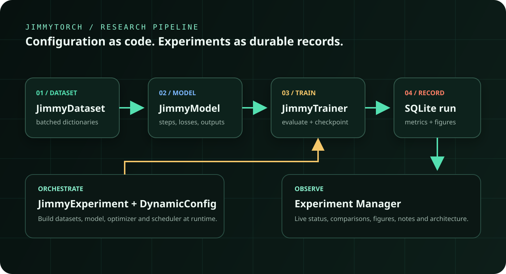
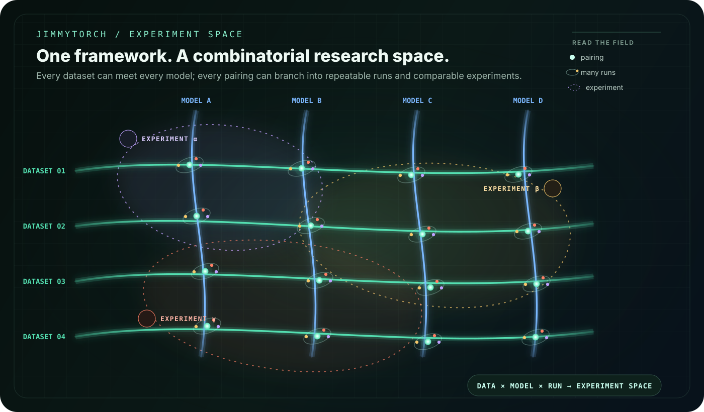

<h1 align="center">
  
</h1>

<p align="center">
  一个紧凑的 PyTorch 科研框架，把数据集、模型和训练循环连接成可复现、可观察的实验。
</p>

<p align="center">
  <a href="docs/index.html"></a>
  
  
  <a href="LICENSE"></a>
</p>

<p align="center">
  <a href="README.md">English</a> · <a href="README.cn.md">简体中文</a>
</p>

<p align="center">
  
</p>

## 从科研代码到实验依据

JimmyTorch 通过少量明确的接口组织完整科研流程，而不是用庞大的训练平台隐藏研究代码：

| 构建 | 运行 | 观察 |
|---|---|---|
| 字典式数据集接口、可复用模型组件 | 代码化配置、混合精度、评估、调度与检查点 | SQLite 实验记录、实时进度、跨实验对比、图像、笔记与模型结构 |

训练循环不依赖浏览器服务。实验数据首先保存在本地，实时状态则通过异步、尽力而为的方式上报。

## 灵活的实验组合空间

<p align="center">
  
</p>

数据集和模型是可以自由复用的维度，而不是固定的一对一关系。每种组合都可以采用不同配置反复运行，并作为可对比的实验结果保留下来。

## Experiment Manager

<p align="center">
  
</p>

一个独立服务即可同时查看当前训练和历史实验，包括资源状态、运行时学习率控制、实验树、标量曲线对比、图像、摘要、笔记和模型结构视图。

## 快速开始

```bash
git clone https://github.com/JinmingWang/JimmyTorch.git
cd JimmyTorch

# 可选：在一个终端启动监控服务。
python -m Training.ExperimentManager

# 在另一个终端运行自带的 MNIST 示例。
python main.py
```

当前仓库直接从源码使用，尚未提供固定版本的依赖清单。请先为当前平台安装 PyTorch，再参考英文的[入门指南](docs/getting-started.html)安装运行时和可选依赖。

## 项目结构

```text
Datasets/                     批处理接口与数据预处理工具
Models/                       模型基类、网络层、损失和注意力模块
DiffusionModels/              DDPM、DDIM、Score-SDE 与 DPM-Solver++ 过程
Training/ExperimentManager/   本地记录、实时客户端、服务端与可视化界面
JimmyExperiment.py            组件构建与实验生命周期
JimmyTrainer.py               训练、评估、调度与检查点
SKILL/jimmytorch/              面向 LLM 的项目指南
docs/                          面向开发者的英文文档
```

## 文档

- [架构概览](docs/index.html)
- [入门指南](docs/getting-started.html)
- [数据集开发](docs/datasets.html)
- [模型开发](docs/models.html)
- [训练与评估](docs/training.html)
- [Experiment Manager](docs/experiment-manager.html)
- [专项工具](docs/utilities.html)
- [API 参考](docs/api.html)

## 分布式训练（独立入口）

原有 `JimmyModel`、`JimmyDataset`、`JimmyTrainer`、`JimmyExperiment` 及 `python main.py` 保持原来的接口和行为。新项目可显式使用 `Distributed` 包中的 `DistributedJimmy*` 类；不需要将旧项目改成新的损失函数接口。

```bash
# 单机四卡：batch_size 表示每张 GPU 的批量大小。
torchrun --standalone --nproc-per-node=4 distributed_main.py

# 两台机器，每台四卡。两台都执行，将 NODE_RANK 分别改为 0 和 1。
# PRIMARY_HOST 是主节点可访问的主机名或 IP。
JIMMY_DASHBOARD_HOST=PRIMARY_HOST torchrun --nnodes=2 --nproc-per-node=4 \
  --node-rank=NODE_RANK --master-addr=PRIMARY_HOST --master-port=29500 \
  --max-restarts=0 distributed_main.py
```

在主节点启动网页服务：`python -m Training.ExperimentManager --host 0.0.0.0 --port 9000`。各节点使用相同代码和逻辑一致的数据；`data_prepare_scope` 可选 `none`（已准备好）、`shared`（全局准备一次）或 `per_node`（每台机器准备一次）。

新模型仍使用 `trainStep(batch)`，其中通过 `self(...)` 前向计算，并且每批调用一次 `self.backwardOptimize(loss)`。可以自定义优化方法，但各 rank 的前向/反向流程必须一致。首版不支持多优化器、梯度累积或弹性恢复。验证、日志和权重保存由全局 rank 0 执行；学习率不会自动缩放，BatchNorm 统计保持每卡独立。检查点只保存模型权重。

Experiment Manager 同时适配旧流程和新流程，按机器显示所有可检测 GPU，包括空闲设备和训练 rank 分配。读数是设备整体使用量；缺失读数显示“—”，过期的节点报告会单独标记。安装 `nvidia-ml-py` 可启用 NVIDIA 监控。详见[分布式训练指南](docs/distributed.html)。

## 项目状态

JimmyTorch 是一个随着实际研究持续演进的个人科研框架。在其他项目中使用时，请结合当前源码和文档进行确认。

项目采用 [Apache License 2.0](LICENSE) 许可证。
