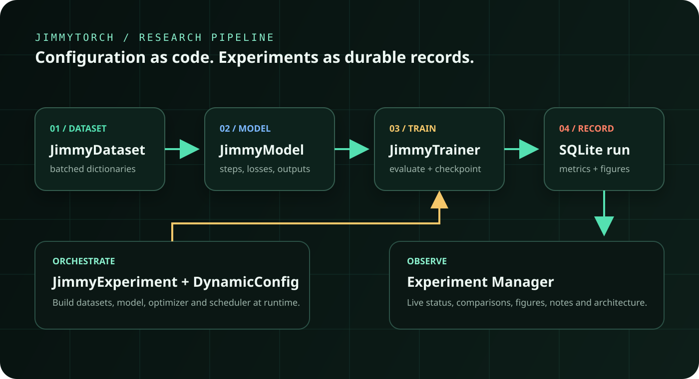
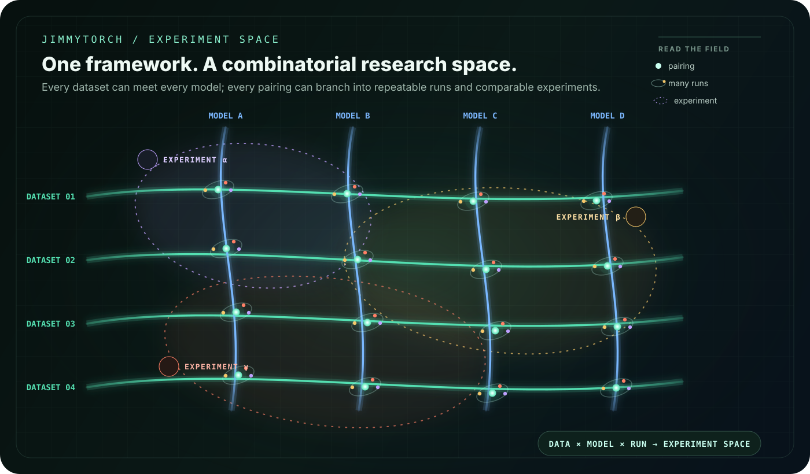

<h1 align="center">
  
</h1>

<p align="center">
  A compact PyTorch research framework for turning datasets, models, and training loops into reproducible, observable experiments.
</p>

<p align="center">
  <a href="docs/index.html"></a>
  
  
  <a href="LICENSE"></a>
</p>

<p align="center">
  <a href="README.md">English</a> · <a href="README.cn.md">简体中文</a>
</p>

<p align="center">
  
</p>

## One loop, from research code to evidence

JimmyTorch provides a small set of explicit contracts rather than hiding research code behind a large training platform:

| Build | Run | Observe |
|---|---|---|
| Dictionary-based datasets and reusable model components | Configuration-as-code, mixed precision, evaluation, scheduling, and checkpoints | SQLite run records, live progress, comparisons, figures, notes, and model architecture |

The training loop remains independent from the browser service. Runs are logged locally, while live status reporting is asynchronous and best-effort.

## A combinatorial experiment space

<p align="center">
  
</p>

Datasets and models are reusable dimensions rather than one-to-one pairs. Combine them freely, repeat each pairing with different run configurations, and retain the results as comparable experiments.

## Experiment Manager

<p align="center">
  
</p>

One standalone dashboard can follow current training and inspect historical runs. It includes resource metrics, runtime learning-rate control, a searchable run tree, multi-run scalar curves, stored figures, summaries, notes, and architecture views.

## Quick start

```bash
git clone https://github.com/JinmingWang/JimmyTorch.git
cd JimmyTorch

# Optional: start the dashboard in one terminal.
python -m Training.ExperimentManager

# Run the included MNIST example in another terminal.
python main.py
```

The repository is currently used directly from source and does not provide a pinned dependency manifest. Install PyTorch for your platform, then see the [getting-started guide](docs/getting-started.html) for runtime and optional dependencies.

## Distributed training (opt-in)

The original `JimmyModel`, `JimmyDataset`, `JimmyTrainer`, `JimmyExperiment`, and `python main.py` workflow remain unchanged. The separate `Distributed` package supplies corresponding `DistributedJimmy*` classes. Models retain `trainStep` and `backwardOptimize`; there is no new loss hook to migrate to.

```bash
# One machine, four GPUs; batch_size is per GPU.
torchrun --standalone --nproc-per-node=4 distributed_main.py

# Two machines, four GPUs each: run on each machine, changing NODE_RANK to 0 or 1.
# PRIMARY_HOST is the primary machine's reachable hostname/IP.
JIMMY_DASHBOARD_HOST=PRIMARY_HOST torchrun --nnodes=2 --nproc-per-node=4 \
  --node-rank=NODE_RANK --master-addr=PRIMARY_HOST --master-port=29500 \
  --max-restarts=0 distributed_main.py
```

Launch the dashboard on the primary machine with `python -m Training.ExperimentManager --host 0.0.0.0 --port 9000`. All workers need identical code and logical datasets. Validation, run files, and weight checkpoints belong to global rank 0; learning rates are not automatically scaled. See the [distributed guide](docs/distributed.html) for configuration, custom hooks, preparation scopes, and limits.

Experiment Manager supports both pipelines, displaying all detected GPUs and grouping distributed resources by machine. Install `nvidia-ml-py` for device-wide NVIDIA telemetry; unavailable monitoring does not stop training.

## Structure

```text
Datasets/                     Batch contracts and preprocessing utilities
Models/                       Model base class, layers, losses, and attention
DiffusionModels/              DDPM, DDIM, Score-SDE, and DPM-Solver++ processes
Training/ExperimentManager/   Local logging, live client, server, and dashboard
JimmyExperiment.py            Component assembly and run lifecycle
JimmyTrainer.py               Training, evaluation, scheduling, and checkpoints
SKILL/jimmytorch/              LLM-facing project guidance
docs/                          Human-facing documentation
```

## Documentation

- [Architecture and overview](docs/index.html)
- [Getting started](docs/getting-started.html)
- [Dataset development](docs/datasets.html)
- [Model development](docs/models.html)
- [Training and evaluation](docs/training.html)
- [Experiment Manager](docs/experiment-manager.html)
- [Specialized utilities](docs/utilities.html)
- [API reference](docs/api.html)

## Project status

JimmyTorch is a personal research framework that evolves with active experiments. Review the current source and documentation together when adopting it in another project.

Licensed under the [Apache License 2.0](LICENSE).
